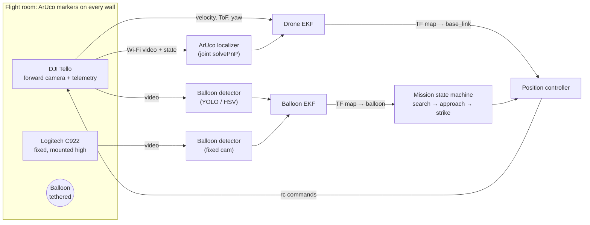

# Tello Balloon Hunter

**EECS C106A / 206A, Fall 2026: Final Project**

A DJI Tello localizes itself in a room covered with ArUco markers (TF tree + our own EKF), finds a balloon with its camera and a fixed Logitech C922, flies to it and pops it.

> **New to the repo? Start here:**
> 1. Look at **[STATUS.md](STATUS.md)** to see what is done, what is in progress and what is free to take.
> 2. Pick an open, unassigned issue in **[Issues](../../issues)** and assign yourself.
> 3. Read **[CONTRIBUTING.md](CONTRIBUTING.md)** for the workflow (branch, PR, `Closes #N`).

<!-- STATUS:START -->
_Progress summary is generated automatically from the issues. See [STATUS.md](STATUS.md)._
<!-- STATUS:END -->

---

## The project in one picture



## Sensing, planning and actuation (course requirement)

| Requirement | How we meet it |
|---|---|
| **Sensing** | Tello forward camera, Tello telemetry (optical-flow velocity, ToF height, IMU yaw), fixed Logitech C922 |
| **Planning** | Mission state machine, waypoint navigation, approach planning toward the balloon frame |
| **Actuation** | Closed-loop position control and visual servoing of the Tello through `rc` velocity commands |
| **Hardware** | Real Tello flying in a real room. Simulation is a development tool only, never the final result. |

## Key dates

| Date | Deliverable |
|---|---|
| Week 12 (Nov 9–13) | Check-In 1 with a GSI (short presentation) |
| **Nov 20, 12 pm** | **Material purchase deadline ($55 budget)** |
| Week 14 | Check-In 2 with a GSI |
| **Dec 10–11** | **Showcase: demo + 10-minute presentation** |
| **Dec 18, 11:59 pm** | **Report website + peer evaluations** |

No extensions on any project deadline. Full schedule: [docs/PLAN.md](docs/PLAN.md#timeline).

## Documentation

| Document | What's inside |
|---|---|
| [STATUS.md](STATUS.md) | Live progress per milestone and workstream, who is doing what (auto-generated) |
| [docs/PLAN.md](docs/PLAN.md) | Full work plan: workstreams, every task with its definition of done, timeline, critical path, roles, risks |
| [docs/ARCHITECTURE.md](docs/ARCHITECTURE.md) | TF tree, ROS 2 nodes and topics, EKF design (state, models), controller, mission state machine |
| [docs/HARDWARE_AND_CONSTRAINTS.md](docs/HARDWARE_AND_CONSTRAINTS.md) | Real hardware limits (Tello, C922), room constraints, what we must measure in week 1 |
| [CONTRIBUTING.md](CONTRIBUTING.md) | How we work: issues, branches, PRs, data, weekly sync |

## Team

| Name | Role | GitHub |
|---|---|---|
| _TBD_ | Drone & control | |
| _TBD_ | Localization & mapping | |
| _TBD_ | State estimation | |
| _TBD_ | Perception | |
| _TBD_ | Mission, integration & report | |

## Repository layout (planned)

```
src/                 ROS 2 packages (see src/README.md)
docs/                plan, architecture, hardware notes
config/              camera calibrations, markers.yaml, EKF parameters
tools/               scripts (status generator, data tools)
```
