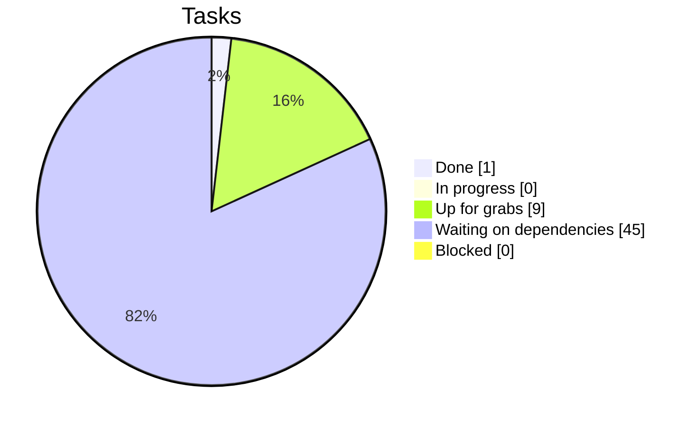

# Project Status

> 🤖 Auto-generated from the GitHub issues by `tools/update_status.py` on every issue change. **Do not edit by hand**: update the issues instead.
> 🔴 = critical path · ✨ = stretch

## Overall: 1 / 55 tasks done (2%)

`█░░░░░░░░░░░░░░░░░░░░░░░░░░░░░░░░░░░░░░░`

## Milestones

| Milestone | Due | Progress | Done |
|---|---|---|---|
| [M1: Infrastructure](https://github.com/clementdumeril/tello-balloon-hunter/milestone/1) | 2026-11-15 | `█░░░░░░░░░░░░░░░░░░░` 6% | 1/17 |
| [M2: TF chain validated (hand-held)](https://github.com/clementdumeril/tello-balloon-hunter/milestone/2) | 2026-11-22 | `░░░░░░░░░░░░░░░░░░░░` 0% | 0/12 |
| [M3: Estimation & autonomous flight](https://github.com/clementdumeril/tello-balloon-hunter/milestone/3) | 2026-11-29 | `░░░░░░░░░░░░░░░░░░░░` 0% | 0/8 |
| [M4: Balloon perception](https://github.com/clementdumeril/tello-balloon-hunter/milestone/4) | 2026-12-02 | `░░░░░░░░░░░░░░░░░░░░` 0% | 0/6 |
| [M5: Interception (feature freeze)](https://github.com/clementdumeril/tello-balloon-hunter/milestone/5) | 2026-12-06 | `░░░░░░░░░░░░░░░░░░░░` 0% | 0/6 |
| [M6: Demo & report](https://github.com/clementdumeril/tello-balloon-hunter/milestone/6) | 2026-12-18 | `░░░░░░░░░░░░░░░░░░░░` 0% | 0/6 |

## Workstreams

| Workstream | Progress | Done | In progress |
|---|---|---|---|
| **A** · Drone & infrastructure | `░░░░░░░░░░░░` 0% | 0/8 | 0 |
| **B** · Calibration & marker map | `░░░░░░░░░░░░` 0% | 0/8 | 0 |
| **C** · Localization & TF | `░░░░░░░░░░░░` 0% | 0/5 | 0 |
| **D** · Simulation | `████░░░░░░░░` 33% | 1/3 | 0 |
| **E** · State estimation (EKF) | `░░░░░░░░░░░░` 0% | 0/8 | 0 |
| **F** · Control | `░░░░░░░░░░░░` 0% | 0/3 | 0 |
| **G** · Perception (balloon) | `░░░░░░░░░░░░` 0% | 0/6 | 0 |
| **H** · Mission & interception | `░░░░░░░░░░░░` 0% | 0/6 | 0 |
| **I** · Evaluation & deliverables | `░░░░░░░░░░░░` 0% | 0/8 | 0 |

## Who is doing what

_Nobody has claimed a task yet. Assign yourself on an issue!_

## 🙋 Up for grabs: ready to start now

Dependencies are done and nobody is assigned. **Pick from the top.**

| Task | Workstream | Milestone |
|---|---|---|
| [**A8**](https://github.com/clementdumeril/tello-balloon-hunter/issues/8) Purchase list submitted before Nov 20, 12 pm 🔴 | A | M1 |
| [**B3**](https://github.com/clementdumeril/tello-balloon-hunter/issues/11) Generate, print and mount ArUco markers 🔴 | B | M1 |
| [**B4**](https://github.com/clementdumeril/tello-balloon-hunter/issues/12) Room survey and marker layout 🔴 | B | M1 |
| [**D1**](https://github.com/clementdumeril/tello-balloon-hunter/issues/22) Python toy simulator with ground truth 🔴 | D | M1 |
| [**E1**](https://github.com/clementdumeril/tello-balloon-hunter/issues/25) Drone EKF math document 🔴 | E | M1 |
| [**I1**](https://github.com/clementdumeril/tello-balloon-hunter/issues/48) Check-In 1 presentation (week 12) 🔴 | I | M1 |
| [**A1**](https://github.com/clementdumeril/tello-balloon-hunter/issues/1) Repo, ROS 2 workspace and package skeleton | A | M1 |
| [**C1**](https://github.com/clementdumeril/tello-balloon-hunter/issues/17) TF tree definition and frame conventions | C | M1 |
| [**I8**](https://github.com/clementdumeril/tello-balloon-hunter/issues/55) Media log: photos and videos at every stage | I | M6 |

⏳ Waiting on dependencies (45)

| Task | Waiting on | Milestone |
|---|---|---|
| [**A2**](https://github.com/clementdumeril/tello-balloon-hunter/issues/2) Tello ROS 2 driver node (djitellopy) 🔴 | A1 | M1 |
| [**A3**](https://github.com/clementdumeril/tello-balloon-hunter/issues/3) Safety layer: emergency land, watchdog, limits, low battery 🔴 | A2 | M1 |
| [**A4**](https://github.com/clementdumeril/tello-balloon-hunter/issues/4) Logitech C922 camera node | A1 | M1 |
| [**A5**](https://github.com/clementdumeril/tello-balloon-hunter/issues/5) Measure Tello video latency and frame drops 🔴 | A2 | M1 |
| [**A6**](https://github.com/clementdumeril/tello-balloon-hunter/issues/6) Characterize Tello telemetry (units, resolution, frame, rate) 🔴 | A2 | M1 |
| [**A7**](https://github.com/clementdumeril/tello-balloon-hunter/issues/7) Rosbag recording scripts and test procedure | A2, A4 | M1 |
| [**B1**](https://github.com/clementdumeril/tello-balloon-hunter/issues/9) Tello camera intrinsic calibration 🔴 | A2 | M1 |
| [**B2**](https://github.com/clementdumeril/tello-balloon-hunter/issues/10) Logitech C922 intrinsic calibration | A4 | M1 |
| [**B5**](https://github.com/clementdumeril/tello-balloon-hunter/issues/13) Marker map v1: hand-measured markers.yaml 🔴 | B3, B4 | M2 |
| [**B7**](https://github.com/clementdumeril/tello-balloon-hunter/issues/15) Logitech extrinsics: map -> logitech_cam | B2, B5 | M2 |
| [**C2**](https://github.com/clementdumeril/tello-balloon-hunter/issues/18) Static TF publishers | B5, B7, C1 | M2 |
| [**C3**](https://github.com/clementdumeril/tello-balloon-hunter/issues/19) ArUco localizer: joint solvePnP over all visible markers 🔴 | B1, C2 | M2 |
| [**C4**](https://github.com/clementdumeril/tello-balloon-hunter/issues/20) Hand-held validation of the TF chain 🔴 | C3 | M2 |
| [**D3**](https://github.com/clementdumeril/tello-balloon-hunter/issues/24) Simulated quadrotor with Tello-like interface, latency and H.264 | A5 | M2 |
| [**E2**](https://github.com/clementdumeril/tello-balloon-hunter/issues/26) EKF implementation validated on the toy simulator 🔴 | E1, D1 | M2 |
| [**E3**](https://github.com/clementdumeril/tello-balloon-hunter/issues/27) Outlier gating (chi-square) and angle wrapping 🔴 | E2 | M2 |
| [**F1**](https://github.com/clementdumeril/tello-balloon-hunter/issues/33) Identify the Tello response to rc commands | A2, A3 | M2 |
| [**G1**](https://github.com/clementdumeril/tello-balloon-hunter/issues/36) Balloon dataset collection (Tello + C922) | A2, A4 | M2 |
| [**G3**](https://github.com/clementdumeril/tello-balloon-hunter/issues/38) HSV color baseline detector | G1 | M2 |
| [**I2**](https://github.com/clementdumeril/tello-balloon-hunter/issues/49) Ground-truth and evaluation protocol | C4 | M2 |
| [**B6**](https://github.com/clementdumeril/tello-balloon-hunter/issues/14) Marker map v2: automatic estimation and optimization | B1, B5 | M3 |
| [**E4**](https://github.com/clementdumeril/tello-balloon-hunter/issues/28) Delayed-measurement handling | E2, A5 | M3 |
| [**E5**](https://github.com/clementdumeril/tello-balloon-hunter/issues/29) drone_ekf ROS 2 node 🔴 | E3, C3, A6 | M3 |
| [**E6**](https://github.com/clementdumeril/tello-balloon-hunter/issues/30) Tune Q and R on real data | E5, A7 | M3 |
| [**F2**](https://github.com/clementdumeril/tello-balloon-hunter/issues/34) Position controller (PID x, y, z, yaw) 🔴 | E5, F1 | M3 |
| [**F3**](https://github.com/clementdumeril/tello-balloon-hunter/issues/35) Waypoint navigation 🔴 | F2 | M3 |
| [**G2**](https://github.com/clementdumeril/tello-balloon-hunter/issues/37) Annotation and dataset split | G1 | M3 |
| [**I5**](https://github.com/clementdumeril/tello-balloon-hunter/issues/52) Check-In 2 presentation (week 14) | I1 | M3 |
| [**C5**](https://github.com/clementdumeril/tello-balloon-hunter/issues/21) Logitech drone tracking (background subtraction) ✨ | B7 | M4 |
| [**E7**](https://github.com/clementdumeril/tello-balloon-hunter/issues/31) Balloon EKF (Tello + Logitech detections) | E2, G5, G6 | M4 |
| [**G4**](https://github.com/clementdumeril/tello-balloon-hunter/issues/39) Fine-tune YOLOv8n / YOLO11n | G2, G3 | M4 |
| [**G5**](https://github.com/clementdumeril/tello-balloon-hunter/issues/40) balloon_detector node on the Tello stream 🔴 | G4, B1 | M4 |
| [**G6**](https://github.com/clementdumeril/tello-balloon-hunter/issues/41) Balloon detection on the Logitech image | G3, B7 | M4 |
| [**H1**](https://github.com/clementdumeril/tello-balloon-hunter/issues/42) Pin mount design and attachment | A8 | M4 |
| [**B8**](https://github.com/clementdumeril/tello-balloon-hunter/issues/16) Portable marker setup for the demo + confirm demo logistics 🔴 | B5 | M5 |
| [**H2**](https://github.com/clementdumeril/tello-balloon-hunter/issues/43) Mission state machine 🔴 | F3 | M5 |
| [**H3**](https://github.com/clementdumeril/tello-balloon-hunter/issues/44) Search behavior | H2, E7 | M5 |
| [**H4**](https://github.com/clementdumeril/tello-balloon-hunter/issues/45) Approach phase 1: TF navigation to standoff 🔴 | E7, F2, H2 | M5 |
| [**H5**](https://github.com/clementdumeril/tello-balloon-hunter/issues/46) Approach phase 2: visual servoing strike 🔴 | H4, G5, H1 | M5 |
| [**H6**](https://github.com/clementdumeril/tello-balloon-hunter/issues/47) End-to-end rehearsals 🔴 | H5 | M5 |
| [**E8**](https://github.com/clementdumeril/tello-balloon-hunter/issues/32) Benchmark against robot_localization ✨ | E5 | M6 |
| [**I3**](https://github.com/clementdumeril/tello-balloon-hunter/issues/50) Localization evaluation: raw vs EKF | E6, I2 | M6 |
| [**I4**](https://github.com/clementdumeril/tello-balloon-hunter/issues/51) Interception evaluation | H6 | M6 |
| [**I6**](https://github.com/clementdumeril/tello-balloon-hunter/issues/53) Showcase presentation and demo video (Dec 10-11) 🔴 | H6 | M6 |
| [**I7**](https://github.com/clementdumeril/tello-balloon-hunter/issues/54) Report website + peer evaluations (Dec 18) 🔴 | I3, I4 | M6 |

## ✅ Recently done

- 2026-11-07: [**D2**](https://github.com/clementdumeril/tello-balloon-hunter/issues/23) Gazebo Harmonic world (room, markers, fixed camera, balloon)
