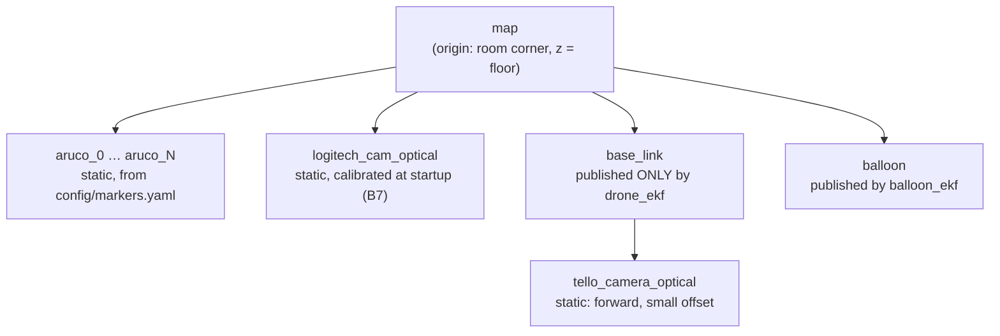
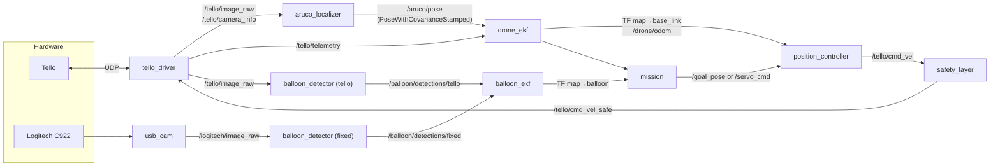
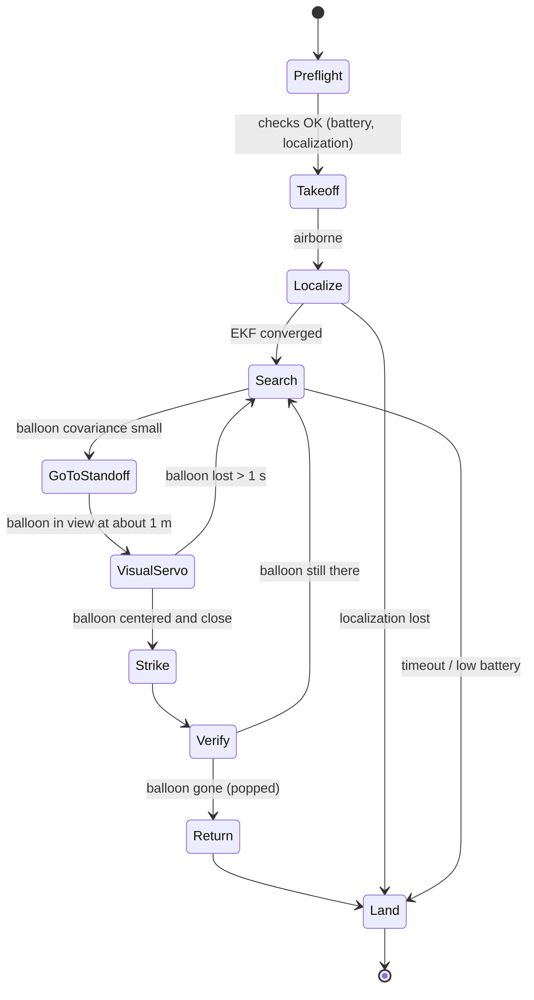

# Architecture

- [Frames and TF tree](#frames-and-tf-tree)
- [ROS 2 nodes and topics](#ros-2-nodes-and-topics)
- [Localization from ArUco markers](#localization-from-aruco-markers)
- [Drone EKF](#drone-ekf)
- [Balloon EKF](#balloon-ekf)
- [Control](#control)
- [Mission state machine](#mission-state-machine)
- [Simulation strategy](#simulation-strategy)

---

## Frames and TF tree

Conventions follow ROS REP-103 and REP-105: x forward, y left, z up, in meters and radians. Camera frames use the optical convention (z forward, x right, y down) and carry the suffix `_optical`.

**Rule:** a frame has exactly one publisher. The ArUco localizer does **not** publish TF. It publishes a pose measurement, and `drone_ekf` alone publishes `map → base_link`.

## ROS 2 nodes and topics

| Package | Nodes | Owner role |
|---|---|---|
| `tello_driver` | `tello_driver`, `safety_layer`, `teleop` | Drone & control |
| `aruco_localization` | `aruco_localizer`, `marker_map_publisher`, `marker_mapper` (B6), `fixed_cam_extrinsics` | Localization & mapping |
| `estimation` | `drone_ekf`, `balloon_ekf` (+ pure-Python EKF library, unit tested) | State estimation |
| `perception` | `balloon_detector` (YOLO or HSV backend) | Perception |
| `control` | `position_controller`, `visual_servo` | Drone & control |
| `mission` | `mission` (state machine) | Mission & integration |
| `sim` | toy simulator (pure Python), optional Gazebo world | State estimation |

## Localization from ArUco markers

When the Tello camera sees markers whose poses in `map` are known from `markers.yaml`:

1. Detect the markers (`cv2.aruco`, dictionary `DICT_4X4_50`) and refine the corners to subpixel accuracy.
2. Gather **the 3D corners of all visible markers** in `map` together with their 2D detections, and solve **one** `solvePnP` (then refine with Levenberg–Marquardt). This is much more accurate than averaging single-marker poses, and it removes the planar "flip" ambiguity of a single marker.
3. Compose with the camera mount:

$$T_{map}^{base} = T_{map}^{cam} \cdot \left(T_{base}^{cam}\right)^{-1}$$

4. Estimate a covariance from the reprojection residuals (or from a model fitted on the C4 data as a function of distance and number of markers), and publish it as a measurement for the EKF.

**Reject a solution** when fewer than 4 corners are visible, the reprojection error is too large, or the jump from the EKF prediction fails the χ² gate (that test lives in the EKF).

**Fixed camera extrinsics (B7).** A reference marker in the C922 view gives $T_{logi}^{ref}$, and therefore $T_{map}^{logi} = T_{map}^{ref} \cdot (T_{logi}^{ref})^{-1}$. This is computed once at startup and then published as a static transform.

## Drone EKF

### State

$$\mathbf{x} = [\,p_x,\ p_y,\ p_z,\ v_x,\ v_y,\ v_z,\ \psi,\ \dot\psi,\ b_\psi\,]^\top$$

Positions and velocities are expressed in `map`. $\psi$ is the yaw, and $b_\psi$ is the offset between the Tello's internal yaw reference (its heading at power-on) and `map`, modeled as a slow random walk.

### Process model

- **v1: constant velocity**, driven by white acceleration noise, at about 50 Hz.
- **v2: command input.** The first-order response identified in F1, $\dot v = (k\,u - v)/\tau$, where $u$ is the `rc` command rotated into `map`.

### Measurements

| Source | Measurement $z$ | Model $h(\mathbf{x})$ | Notes |
|---|---|---|---|
| ArUco pose | $[p_x, p_y, p_z, \psi]$ | linear | Delayed by the video latency (A5), covariance from the localizer |
| Tello velocity | $[v^b_x, v^b_y, v_z]$ | $R_z(\psi)^\top [v_x, v_y]^\top,\ v_z$ | **Nonlinear in ψ, hence the EKF.** Units, resolution and frame to be confirmed in A6 (likely integer dm/s, i.e. 0.1 m/s quantization) |
| ToF height | $h$ | $p_z$ | Assumes a flat floor; reject readings over furniture |
| IMU yaw | $\psi_{imu}$ | $\psi - b_\psi$ | Fast, slowly drifting |

### Robustness

- **χ² gating:** reject a measurement when $\nu^\top S^{-1} \nu > \chi^2_{k,\,0.99}$.
- **Angle wrapping:** wrap ψ and every yaw innovation into $[-\pi, \pi]$.
- **Delayed measurements (E4):** keep a ring buffer of (state, covariance, input) over about 1 s. When an image-based measurement stamped at $t_{img} = t_{rx} - \hat{\tau}_{latency}$ arrives, roll back to $t_{img}$, apply the update, then re-propagate to now.

### Validation

On the toy simulator: RMSE against ground truth, NEES and NIS consistency, and innovation plots. On hardware: the C4 and I2 protocols.

## Balloon EKF

- **State:** $\mathbf{x}_b = [b_x, b_y, b_z]^\top$ in `map`. The balloon is tethered, so its position is modeled as a slow random walk.
- **Measurements:** pixel center $(u, v)$ plus apparent diameter $d$ from each camera, through the pinhole model and the known balloon diameter $D$:
  - Range estimate: $r \approx f D / d$
  - Tello measurements go through $T_{map}^{cam}$ from the drone EKF, so their uncertainty also includes the drone pose uncertainty.
  - C922 measurements go through the static $T_{map}^{logi}$.
- When there is no detection, the filter keeps predicting and the covariance grows. The mission uses that covariance to decide between searching and approaching.

## Control

- **Position controller:** a PID on the position error in `map`, rotated into the body frame, saturated, then sent as `rc` commands. Yaw uses a separate PID. The D term uses the **EKF velocity**, not a derivative of a noisy pose.
- **Visual servoing (final approach):** yaw rate ∝ horizontal pixel error of the balloon, $v_z$ ∝ vertical pixel error, and forward speed from a profile on the apparent balloon size. The pin is aligned with the image center (calibrated in H1).
- **Safety layer:** speed limits, command watchdog (hover if no command arrives for more than 0.3 s), emergency land key, low-battery land.

## Mission state machine

Any state can trigger an emergency land, through the operator key or the watchdog.

## Simulation strategy

The course requires the final result on real hardware. Simulation **only speeds up development**.

| Tool | Used for | Not used for |
|---|---|---|
| **Python toy simulator (D1)** | Developing and tuning the EKFs with exact ground truth, outliers and delays | Anything visual |
| **Rosbag replay** | Perception evaluation (real compression, real lighting), offline localizer and EKF testing | Closed-loop control |
| **Gazebo Fortress (stretch, D2–D3)** | Closed-loop tests of the controller and mission, with injected latency and H.264 compression | YOLO accuracy, which suffers from the sim-to-real gap |
