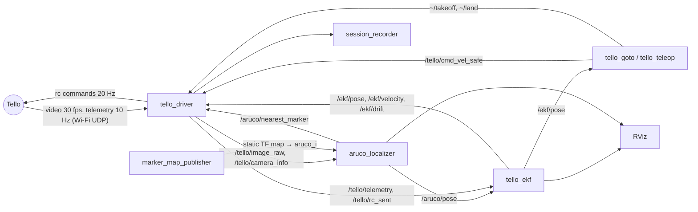

# Architecture

What runs, who talks to whom, and where each piece of code is. Everything below is implemented and flies.

## The idea in four steps

1. **See the markers** ([ARUCO.md](ARUCO.md)). The camera image goes to the ArUco localizer, which computes where the drone is in the room
   (`map` frame) from the marker map measured beforehand (`config/markers.yaml`).
2. **Know where it is all the time.** The EKF fuses that pose with the commands really sent, the distance sensor and
   the IMU heading. It compensates the ~0.5 s delay and keeps estimating for a few seconds without markers.
3. **Decide where to go.** A mission (or the teleop) asks for a velocity on `/tello/cmd_vel_safe`.
4. **Fly safely.** The driver passes every request through its safety chain, then sends it to the Tello.

## ROS 2 graph



| Node | File | Role |
|---|---|---|
| `tello_driver` | `tello_driver/driver.py` | Link to the drone (djitellopy), video (`video_reader.py`), telemetry, takeoff + climb, landing; every command goes through `safety.py` |
| `aruco_localizer` | `aruco_localization/aruco_localizer.py` | One joint PnP over the corners of all visible markers → `/aruco/pose`; distance to the closest marker → `/aruco/nearest_marker` |
| `tello_ekf` | `tello_driver/ekf_node.py` + `ekf_core.py` | Drone state estimate, TF `map → base_link` |
| `marker_map_publisher` | `aruco_localization/marker_map_publisher.py` | Static TF of the markers and the camera mount; room scan and free space for RViz |
| `session_recorder` | `tello_driver/session_recorder.py` | Saves every flight in `~/tello_ws/sessions/<time>/` |
| missions / teleop | `goto_markers.py`, `marker_tour.py`, `strike.py`, `teleop.py` | Velocity requests on `/tello/cmd_vel_safe` |

All nodes are started by `src/tello_driver/launch/real.launch.py` (except the mission / teleop, run in a second
terminal). `mock:=true` replaces the Tello by `fake_tello.py` + `fake_world.py`: a virtual camera renders the real
marker map and the drone moves with the identified dynamics; every other node is the real one.

## What happens to a command (`safety.py`, 20 Hz)

```
request (mission / teleop, zero after 0.5 s without one)
 → climb after takeoff     the Tello stops at ~0.8 m: climb to 1.85 m (middle of the band) where the markers are in view
 → position hold           no horizontal request: hold where the drone stops; no vertical one: hold the height
 → ceiling                 never above 2.6 m (on the height predicted 1 s ahead)
 → height band             not more than 10 cm out of 1.70–2.00 m (the obstacle map is only valid there)
 → flight zone             slow down, brake, push back before the obstacles of the room scan; blind: 0.15 m/s max
 → wall ahead              a marker closer than 0.7 m in the image: no forward motion, back off
→ Tello (rc), and /tello/rc_sent (what was really sent: the EKF's input)
```

The position hold is needed because the Tello's own optical-flow hold does not work on the plain floor of the room.
It predicts the position 0.3 s ahead (command delay), inverts the identified model and cancels the drift learnt by
the EKF. `CommandFilter` has no ROS dependency, so it is tested offline (400 randomized flights with key mashing,
blind periods, wrong poses and model errors).

## Model and EKF

Identified on the real drone: per horizontal axis `tau dv/dt = K u(t - L) - v` with K ≈ 1.1, tau ≈ 0.55 s, and a
total delay of ~0.5 s from command to marker pose (0.30 s command + 0.20 s video).

EKF state `[x, y, z, vx, vy, vz, yaw, b, dx, dy]` (b: IMU heading offset; dx, dy: drift learnt while markers are seen,
bounded to 0.10 m/s and faded out without markers). Input: the commands really sent. Measurements: the marker pose,
applied at the time the image was taken and re-propagated to now (chi-square gate); the distance sensor (gated out
over furniture); the IMU heading. It starts on 3 consistent poses, or on the takeoff pad (`config/home.yaml`).

## Frames

| Frame | Parent | Published by |
|---|---|---|
| `map` | — | room frame: origin on the floor below marker 49, z up |
| `aruco_<id>` | `map` | marker_map_publisher (static), from `config/markers.yaml` |
| `base_link` | `map` | tello_ekf (filtered drone) |
| `base_link_aruco` | `map` | aruco_localizer (raw marker pose) |
| `tello_camera_optical` | `base_link` | marker_map_publisher (static), 5 cm ahead of the body |

## Missions

| Command | What it does |
|---|---|
| `tello_goto 49 35` | Takeoff anywhere ≥ 1 m from the walls, turn on the spot until markers are in view, fly to the room centre; for each marker: turn to face it, go ~0.9 m in front of it (nose kept on the marker), stop 1 s, back to the centre; then back above the takeoff pad and land |
| `tello_marker_tour` | Visit every marker of the map |
| `tello_strike` | Fast planned legs and strike / retreat on target markers (balloon rehearsal) |
| `tello_step_test` | Identification flight (velocity doublets), then `tello_step_fit` fits the model |

ENTER takes off, any key lands, Ctrl+C lands; markers lost: the drone turns to find them, lands after 12 s.

## Configuration and tools

| File | Made by |
|---|---|
| `config/markers.yaml` | `tools/room_mapper.py` (photos of the markers + bundle adjustment) |
| `config/tello_camera.yaml` | `tools/calibrate_camera.py` (checkerboard) |
| `config/flight_zone_band.yaml` (+ grid, png) | `tools/free_zone.py` on the phone scan of the room (`tools/room_mesh_to_map.py`, `tools/align_scan.py`) |
| `config/home.yaml` (local) | `tools/set_home.py`: the takeoff pad (marker 48), learnt from the first poses of each climb |

Other tools: `tools/flight_report.py` (after a flight: markers in view, pose jumps, time in the band, hover spread,
mission tracking error), `tools/ekf_replay.py` (replays a flight through the EKF), `tools/make_print_sheets.py`
(printable markers, in `docs/print/`).
