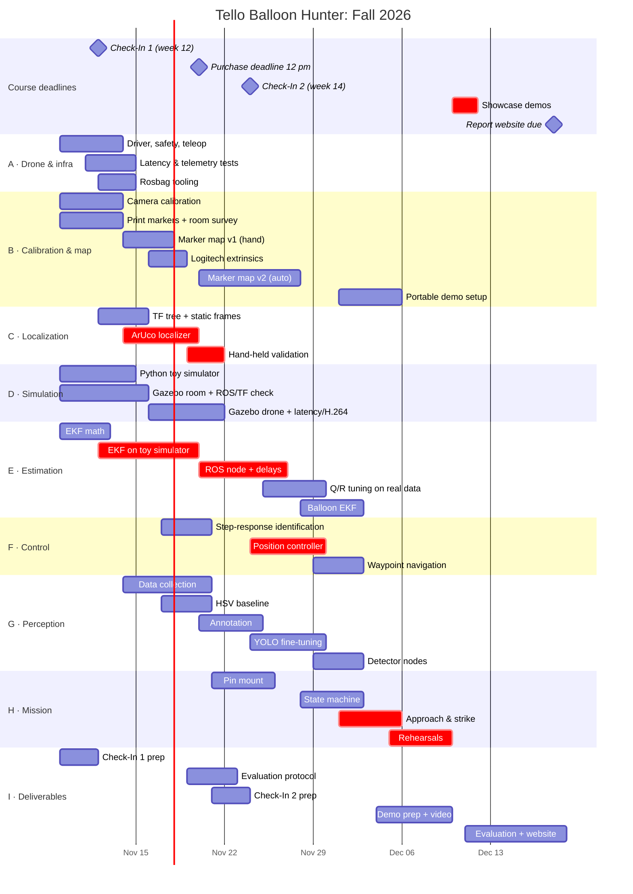
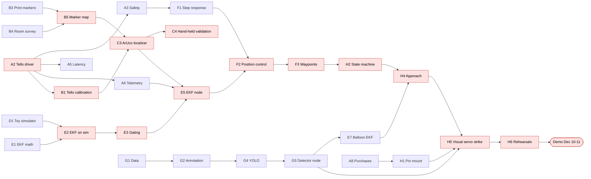

# Work Plan

This is the full plan. **Every task below is also a GitHub issue.** The issue is the source of truth for status and owner, and the live view is in [STATUS.md](../STATUS.md).

- [Scope ladder](#scope-ladder)
- [Milestones](#milestones)
- [Timeline](#timeline)
- [Critical path](#critical-path)
- [Roles](#roles)
- [Tasks by workstream](#tasks-by-workstream)
- [Risks](#risks)

---

## Scope ladder

The course guidelines say: *propose something difficult, with plans to scale it down.* This is our ladder. Each level must work reliably before we invest in the next one.

| Level | Content | Status |
|---|---|---|
| **1. Must have** | Gazebo room to validate the ROS nodes and TF frames before flying · ArUco localization through TF · our own drone EKF · autonomous hover and waypoint flight · balloon detection from the Tello camera · fly into the balloon and pop it | Required for the demo |
| **2. Target** | Fixed Logitech camera locates the balloon for the search phase · balloon EKF fusing both cameras · delayed-measurement handling in the EKF · automatic marker map · quantitative evaluation | What we aim to present |
| **3. Stretch** | Logitech tracking of the drone (background subtraction) · benchmark against `robot_localization` · several balloons in sequence | Only if levels 1 and 2 are solid |

> **Course emphasis:** C106A is a model-based robotics course and is "not particularly interested in learning", nor in chaining off-the-shelf modules. YOLO is one component, not the core of the project. The core is our own localization, estimation (EKF) and control. That is why we write the EKF and the localizer ourselves.

## Milestones

| | Milestone | Due | What "done" looks like |
|---|---|---|---|
| **M1** | Infrastructure | Nov 15 | Drone flown from ROS 2 · both cameras calibrated · Tello latency and telemetry characterized · toy simulator running · Check-In 1 done · purchases ordered |
| **M2** | TF chain validated (hand-held) | Nov 22 | Marker map built · drone carried by hand shows the correct `map → base_link` in RViz · EKF works on the simulator · balloon dataset recorded |
| **M3** | Estimation & autonomous flight | Nov 29 | EKF running live on the drone · hover within the target tolerance · waypoint flight · Check-In 2 done |
| **M4** | Balloon perception | Dec 2 | Balloon detected live from the Tello and the C922 · `balloon` frame from the balloon EKF |
| **M5** | Interception (feature freeze) | Dec 6 | Full mission works end to end several times in a row · portable demo setup ready |
| **M6** | Demo & report | Dec 18 | Showcase on Dec 10–11 · evaluation figures · report website on Dec 18 |

## Timeline

> Check-In dates are approximate (course weeks 12 and 14). Update them once the GSI meetings are booked.

## Critical path

The red path is what delays the demo if it slips. Anything not on it can absorb delays.

**Can start on day one, in parallel:** A1–A2, A8, B3–B4, C1, D1, E1, I1.

## Roles

The group has 4–5 people. Each role owns a set of workstreams, which means it is responsible for those tasks getting done, not that it does everything alone. Everyone joins flight tests and rehearsals.

| Role | Owns | Main deliverable |
|---|---|---|
| **1. Drone & control** | A, F | Driver, safety layer, position controller, waypoint flight |
| **2. Localization & mapping** | B, C | Calibrations, marker map, ArUco localizer, TF tree |
| **3. State estimation** | D, E | Toy simulator, drone EKF, balloon EKF |
| **4. Perception** | G | Dataset, HSV baseline, YOLO, detector nodes |
| **5. Mission & integration** | H, I | Pin mount, state machine, visual servoing, evaluation, check-ins, website |

**With 4 people:** role 5 is shared. Role 1 takes H (mission), role 4 takes I (deliverables) once YOLO is trained.

## Tasks by workstream

<!-- TASKS:START -->
🔴 = critical path · ✨ = stretch · Click an ID to open its issue (status, owner, discussion).

### A · Drone & infrastructure

| ID | Task | Milestone | Depends on | Definition of done |
|---|---|---|---|---|
| [**A1**](https://github.com/clementdumeril/tello-balloon-hunter/issues/1) | Repo, ROS 2 workspace and package skeleton | M1 | – | `colcon build` passes on every member's machine Packages match docs/ARCHITECTURE.md Launch file skeleton exists |
| [**A2**](https://github.com/clementdumeril/tello-balloon-hunter/issues/2) | Tello ROS 2 driver node (djitellopy) 🔴 | M1 | [A1](https://github.com/clementdumeril/tello-balloon-hunter/issues/1) | `/tello/image_raw`, `/tello/camera_info`, `/tello/telemetry` published `/tello/cmd_vel_safe` drives the drone Takeoff/land services Teleop flight works |
| [**A3**](https://github.com/clementdumeril/tello-balloon-hunter/issues/3) | Safety layer: emergency land, watchdog, limits, low battery 🔴 | M1 | [A2](https://github.com/clementdumeril/tello-balloon-hunter/issues/2) | Emergency-land key works from the keyboard Watchdog: hover if no command for > 0.3 s Velocity saturation Auto-land below a battery threshold Each feature tested by hand |
| [**A4**](https://github.com/clementdumeril/tello-balloon-hunter/issues/4) | Logitech C922 camera node | M1 | [A1](https://github.com/clementdumeril/tello-balloon-hunter/issues/1) | `/logitech/image_raw` + `camera_info` at a stable rate Chosen mode documented (720p60 or 1080p30) |
| [**A5**](https://github.com/clementdumeril/tello-balloon-hunter/issues/5) | Measure Tello video latency and frame drops 🔴 | M1 | [A2](https://github.com/clementdumeril/tello-balloon-hunter/issues/2) | Stopwatch-on-screen test done Mean/std latency recorded in docs/HARDWARE_AND_CONSTRAINTS.md Frame-drop rate at 1, 3 and 5 m recorded |
| [**A6**](https://github.com/clementdumeril/tello-balloon-hunter/issues/6) | Characterize Tello telemetry (units, resolution, frame, rate) 🔴 | M1 | [A2](https://github.com/clementdumeril/tello-balloon-hunter/issues/2) | Velocity units, resolution and frame confirmed by moving the drone by hand ToF noise at rest Yaw reference at power-on and drift over 5 min State packet rate Usable flight time Results in docs/HARDWARE_AND_CONSTRAINTS.md |
| [**A7**](https://github.com/clementdumeril/tello-balloon-hunter/issues/7) | Rosbag recording scripts and test procedure | M1 | [A2](https://github.com/clementdumeril/tello-balloon-hunter/issues/2), [A4](https://github.com/clementdumeril/tello-balloon-hunter/issues/4) | One command records all relevant topics Naming convention + team-drive folder Replay tested |
| [**A8**](https://github.com/clementdumeril/tello-balloon-hunter/issues/8) | Purchase list submitted before Nov 20, 12 pm 🔴 | M1 | – | List: spare Tello batteries, prop guards, foam boards, balloons, string, pins, textured mat Form submitted before **Nov 20, 12 pm** Items received |

### B · Calibration & marker map

| ID | Task | Milestone | Depends on | Definition of done |
|---|---|---|---|---|
| [**B1**](https://github.com/clementdumeril/tello-balloon-hunter/issues/9) | Tello camera intrinsic calibration 🔴 | M1 | [A2](https://github.com/clementdumeril/tello-balloon-hunter/issues/2) | Checkerboard calibration with `camera_calibration` Reprojection error reported (target < 0.5 px) YAML committed in config/ |
| [**B2**](https://github.com/clementdumeril/tello-balloon-hunter/issues/10) | Logitech C922 intrinsic calibration | M1 | [A4](https://github.com/clementdumeril/tello-balloon-hunter/issues/4) | Calibration YAML committed in config/ Reprojection error reported |
| [**B3**](https://github.com/clementdumeril/tello-balloon-hunter/issues/11) | Generate, print and mount ArUco markers 🔴 | M1 | – | DICT_4X4_50, unique IDs Mostly 15 cm + a few 20 cm Mounted on rigid foam boards Printed size verified with a ruler |
| [**B4**](https://github.com/clementdumeril/tello-balloon-hunter/issues/12) | Room survey and marker layout 🔴 | M1 | – | Room dimensions and sketch committed Origin and axes defined (room corner, z = floor) Flight box defined Spacing <= 60 cm, 2-3 markers visible from any pose in the flight box |
| [**B5**](https://github.com/clementdumeril/tello-balloon-hunter/issues/13) | Marker map v1: hand-measured markers.yaml 🔴 | M2 | [B3](https://github.com/clementdumeril/tello-balloon-hunter/issues/11), [B4](https://github.com/clementdumeril/tello-balloon-hunter/issues/12) | `config/markers.yaml` with the pose of every marker Measurement method documented Spot-check of 3 markers by a second person |
| [**B6**](https://github.com/clementdumeril/tello-balloon-hunter/issues/14) | Marker map v2: automatic estimation and optimization | M3 | [B1](https://github.com/clementdumeril/tello-balloon-hunter/issues/9), [B5](https://github.com/clementdumeril/tello-balloon-hunter/issues/13) | Marker mapper node or script Comparison against v1 (error per marker) Better map adopted if more accurate |
| [**B7**](https://github.com/clementdumeril/tello-balloon-hunter/issues/15) | Logitech extrinsics: map -> logitech_cam | M2 | [B2](https://github.com/clementdumeril/tello-balloon-hunter/issues/10), [B5](https://github.com/clementdumeril/tello-balloon-hunter/issues/13) | Static transform computed at startup Checked by reprojecting other known markers |
| [**B8**](https://github.com/clementdumeril/tello-balloon-hunter/issues/16) | Portable marker setup for the demo + confirm demo logistics 🔴 | M5 | [B5](https://github.com/clementdumeril/tello-balloon-hunter/issues/13) | Demo logistics confirmed with the GSI (where and how the drone flies) Markers on stands or boards, layout reproducible in < 30 min Marker map for the demo layout Backup demo video recorded |

### C · Localization & TF

| ID | Task | Milestone | Depends on | Definition of done |
|---|---|---|---|---|
| [**C1**](https://github.com/clementdumeril/tello-balloon-hunter/issues/17) | TF tree definition and frame conventions | M1 | – | Frames and conventions documented (REP-103/105, optical frames) One publisher per frame agreed |
| [**C2**](https://github.com/clementdumeril/tello-balloon-hunter/issues/18) | Static TF publishers | M2 | [B5](https://github.com/clementdumeril/tello-balloon-hunter/issues/13), [B7](https://github.com/clementdumeril/tello-balloon-hunter/issues/15), [C1](https://github.com/clementdumeril/tello-balloon-hunter/issues/17) | Markers from markers.yaml in RViz `base_link -> tello_camera_optical` `map -> logitech_cam_optical` |
| [**C3**](https://github.com/clementdumeril/tello-balloon-hunter/issues/19) | ArUco localizer: joint solvePnP over all visible markers 🔴 | M2 | [B1](https://github.com/clementdumeril/tello-balloon-hunter/issues/9), [C2](https://github.com/clementdumeril/tello-balloon-hunter/issues/18) | Joint solvePnP over all visible corners + LM refinement Publishes `/aruco/pose` (PoseWithCovarianceStamped) Rejects bad solutions (few corners, high reprojection error) Runs at camera rate |
| [**C4**](https://github.com/clementdumeril/tello-balloon-hunter/issues/20) | Hand-held validation of the TF chain 🔴 | M2 | [C3](https://github.com/clementdumeril/tello-balloon-hunter/issues/19) | Drone carried to >= 10 tape-measured points Position/yaw error statistics reported Error vs distance / number of markers plotted |
| [**C5**](https://github.com/clementdumeril/tello-balloon-hunter/issues/21) | Logitech drone tracking (background subtraction) ✨ | M4 | [B7](https://github.com/clementdumeril/tello-balloon-hunter/issues/15) | Background subtraction tracks the drone Bearing ray published in `map` Fused in the drone EKF |

### D · Simulation

| ID | Task | Milestone | Depends on | Definition of done |
|---|---|---|---|---|
| [**D1**](https://github.com/clementdumeril/tello-balloon-hunter/issues/22) | Python toy simulator with ground truth 🔴 | M1 | – | Ground-truth trajectories Marker map + simulated ArUco pose, velocity, ToF, yaw measurements Configurable noise, delay, dropouts and outliers Same message structure as the real nodes |
| [**D2**](https://github.com/clementdumeril/tello-balloon-hunter/issues/23) | Gazebo Fortress world (room, markers, fixed camera, balloon) | M1 | [A1](https://github.com/clementdumeril/tello-balloon-hunter/issues/1) | World with ArUco-textured walls Fixed camera Balloon model |
| [**D3**](https://github.com/clementdumeril/tello-balloon-hunter/issues/24) | Simulated quadrotor with Tello-like interface, latency and H.264 | M2 | [D2](https://github.com/clementdumeril/tello-balloon-hunter/issues/23), [A5](https://github.com/clementdumeril/tello-balloon-hunter/issues/5) | Velocity-controlled quadrotor publishing the driver topics Injected latency from A5 H.264 encode/decode node |

### E · State estimation (EKF)

| ID | Task | Milestone | Depends on | Definition of done |
|---|---|---|---|---|
| [**E1**](https://github.com/clementdumeril/tello-balloon-hunter/issues/25) | Drone EKF math document 🔴 | M1 | – | State, process model, measurement models All Jacobians derived Noise parameters listed with how they will be measured |
| [**E2**](https://github.com/clementdumeril/tello-balloon-hunter/issues/26) | EKF implementation validated on the toy simulator 🔴 | M2 | [E1](https://github.com/clementdumeril/tello-balloon-hunter/issues/25), [D1](https://github.com/clementdumeril/tello-balloon-hunter/issues/22) | Unit tests for predict/update and Jacobians (numerical check) RMSE vs ground truth NEES/NIS consistency plots |
| [**E3**](https://github.com/clementdumeril/tello-balloon-hunter/issues/27) | Outlier gating (chi-square) and angle wrapping 🔴 | M2 | [E2](https://github.com/clementdumeril/tello-balloon-hunter/issues/26) | Chi-square gate on every update Yaw wrapping everywhere Simulated outliers rejected |
| [**E4**](https://github.com/clementdumeril/tello-balloon-hunter/issues/28) | Delayed-measurement handling | M3 | [E2](https://github.com/clementdumeril/tello-balloon-hunter/issues/26), [A5](https://github.com/clementdumeril/tello-balloon-hunter/issues/5) | State/covariance ring buffer Rollback and re-propagation Accuracy gain quantified on the simulator and on rosbags |
| [**E5**](https://github.com/clementdumeril/tello-balloon-hunter/issues/29) | drone_ekf ROS 2 node 🔴 | M3 | [E3](https://github.com/clementdumeril/tello-balloon-hunter/issues/27), [C3](https://github.com/clementdumeril/tello-balloon-hunter/issues/19), [A6](https://github.com/clementdumeril/tello-balloon-hunter/issues/6) | Fuses ArUco pose + velocity + ToF + yaw Publishes TF at ~50 Hz + `/drone/odom` with velocity Runs live and on rosbag replay |
| [**E6**](https://github.com/clementdumeril/tello-balloon-hunter/issues/30) | Tune Q and R on real data | M3 | [E5](https://github.com/clementdumeril/tello-balloon-hunter/issues/29), [A7](https://github.com/clementdumeril/tello-balloon-hunter/issues/7) | R from measured sensor noise Q tuned on recorded flights Innovation plots in the issue |
| [**E7**](https://github.com/clementdumeril/tello-balloon-hunter/issues/31) | Balloon EKF (Tello + Logitech detections) | M4 | [E2](https://github.com/clementdumeril/tello-balloon-hunter/issues/26), [G5](https://github.com/clementdumeril/tello-balloon-hunter/issues/40), [G6](https://github.com/clementdumeril/tello-balloon-hunter/issues/41) | Pixel + size measurement models for both cameras Publishes `map -> balloon` + covariance Keeps predicting through missed detections |
| [**E8**](https://github.com/clementdumeril/tello-balloon-hunter/issues/32) | Benchmark against robot_localization ✨ | M6 | [E5](https://github.com/clementdumeril/tello-balloon-hunter/issues/29) | Same rosbags through both Comparison table and plot |

### F · Control

| ID | Task | Milestone | Depends on | Definition of done |
|---|---|---|---|---|
| [**F1**](https://github.com/clementdumeril/tello-balloon-hunter/issues/33) | Identify the Tello response to rc commands | M2 | [A2](https://github.com/clementdumeril/tello-balloon-hunter/issues/2), [A3](https://github.com/clementdumeril/tello-balloon-hunter/issues/3) | Step tests per axis Gain k and time constant tau per axis Hover drift without correction measured |
| [**F2**](https://github.com/clementdumeril/tello-balloon-hunter/issues/34) | Position controller (PID x, y, z, yaw) 🔴 | M3 | [E5](https://github.com/clementdumeril/tello-balloon-hunter/issues/29), [F1](https://github.com/clementdumeril/tello-balloon-hunter/issues/33) | PID in map frame rotated to body frame, D term from EKF velocity Hover error within target (e.g. +-10 cm) over 30 s Gains documented |
| [**F3**](https://github.com/clementdumeril/tello-balloon-hunter/issues/35) | Waypoint navigation 🔴 | M3 | [F2](https://github.com/clementdumeril/tello-balloon-hunter/issues/34) | Waypoint list from a YAML or a topic Path flown 3 times in a row Tracking error plotted |

### G · Perception (balloon)

| ID | Task | Milestone | Depends on | Definition of done |
|---|---|---|---|---|
| [**G1**](https://github.com/clementdumeril/tello-balloon-hunter/issues/36) | Balloon dataset collection (Tello + C922) | M2 | [A2](https://github.com/clementdumeril/tello-balloon-hunter/issues/2), [A4](https://github.com/clementdumeril/tello-balloon-hunter/issues/4) | > 500 frames from the Tello and the C922 Several balloon colors, distances, lighting conditions Stored on the team drive |
| [**G2**](https://github.com/clementdumeril/tello-balloon-hunter/issues/37) | Annotation and dataset split | M3 | [G1](https://github.com/clementdumeril/tello-balloon-hunter/issues/36) | Annotated in Roboflow or CVAT Train/val/test split without leakage between videos |
| [**G3**](https://github.com/clementdumeril/tello-balloon-hunter/issues/38) | HSV color baseline detector | M2 | [G1](https://github.com/clementdumeril/tello-balloon-hunter/issues/36) | Detection rate and false positives on the test split Works as a detector backend |
| [**G4**](https://github.com/clementdumeril/tello-balloon-hunter/issues/39) | Fine-tune YOLOv8n / YOLO11n | M4 | [G2](https://github.com/clementdumeril/tello-balloon-hunter/issues/37), [G3](https://github.com/clementdumeril/tello-balloon-hunter/issues/38) | Augmentation (blur, compression, brightness) mAP reported and compared with the HSV baseline Inference speed on the laptop |
| [**G5**](https://github.com/clementdumeril/tello-balloon-hunter/issues/40) | balloon_detector node on the Tello stream 🔴 | M4 | [G4](https://github.com/clementdumeril/tello-balloon-hunter/issues/39), [B1](https://github.com/clementdumeril/tello-balloon-hunter/issues/9) | Detections published at >= 15 FPS Range from bbox size + known diameter YOLO / HSV backend switch |
| [**G6**](https://github.com/clementdumeril/tello-balloon-hunter/issues/41) | Balloon detection on the Logitech image | M4 | [G3](https://github.com/clementdumeril/tello-balloon-hunter/issues/38), [B7](https://github.com/clementdumeril/tello-balloon-hunter/issues/15) | Detections published with pixel center + size Ray in `map` checked against a measured balloon position |

### H · Mission & interception

| ID | Task | Milestone | Depends on | Definition of done |
|---|---|---|---|---|
| [**H1**](https://github.com/clementdumeril/tello-balloon-hunter/issues/42) | Pin mount design and attachment | M4 | [A8](https://github.com/clementdumeril/tello-balloon-hunter/issues/8) | A few grams, away from the props Pin tip position in the camera image calibrated Drone flies normally with it |
| [**H2**](https://github.com/clementdumeril/tello-balloon-hunter/issues/43) | Mission state machine 🔴 | M5 | [F3](https://github.com/clementdumeril/tello-balloon-hunter/issues/35) | States and transitions as in docs/ARCHITECTURE.md Failsafes: localization lost, timeout, low battery Tested state by state |
| [**H3**](https://github.com/clementdumeril/tello-balloon-hunter/issues/44) | Search behavior | M5 | [H2](https://github.com/clementdumeril/tello-balloon-hunter/issues/43), [E7](https://github.com/clementdumeril/tello-balloon-hunter/issues/31) | Uses the Logitech balloon estimate, or rotates in place Balloon found from 5 random start poses |
| [**H4**](https://github.com/clementdumeril/tello-balloon-hunter/issues/45) | Approach phase 1: TF navigation to standoff 🔴 | M5 | [E7](https://github.com/clementdumeril/tello-balloon-hunter/issues/31), [F2](https://github.com/clementdumeril/tello-balloon-hunter/issues/34), [H2](https://github.com/clementdumeril/tello-balloon-hunter/issues/43) | Standoff pose computed from the balloon frame Reached 5 times in a row |
| [**H5**](https://github.com/clementdumeril/tello-balloon-hunter/issues/46) | Approach phase 2: visual servoing strike 🔴 | M5 | [H4](https://github.com/clementdumeril/tello-balloon-hunter/issues/45), [G5](https://github.com/clementdumeril/tello-balloon-hunter/issues/40), [H1](https://github.com/clementdumeril/tello-balloon-hunter/issues/42) | Yaw/vertical/forward servo laws Balloon popped Abort if the balloon is lost |
| [**H6**](https://github.com/clementdumeril/tello-balloon-hunter/issues/47) | End-to-end rehearsals 🔴 | M5 | [H5](https://github.com/clementdumeril/tello-balloon-hunter/issues/46) | >= 10 full runs logged Every failure analyzed and fixed or mitigated Success rate reported |

### I · Evaluation & deliverables

| ID | Task | Milestone | Depends on | Definition of done |
|---|---|---|---|---|
| [**I1**](https://github.com/clementdumeril/tello-balloon-hunter/issues/48) | Check-In 1 presentation (week 12) 🔴 | M1 | – | GSI slot booked Slides: goal, architecture, plan, first results, questions Ask about demo logistics for a drone |
| [**I2**](https://github.com/clementdumeril/tello-balloon-hunter/issues/49) | Ground-truth and evaluation protocol | M2 | [C4](https://github.com/clementdumeril/tello-balloon-hunter/issues/20) | Tape-marked floor points, procedure written Metrics defined (position RMSE, hover error, success rate, time to pop) |
| [**I3**](https://github.com/clementdumeril/tello-balloon-hunter/issues/50) | Localization evaluation: raw vs EKF | M6 | [E6](https://github.com/clementdumeril/tello-balloon-hunter/issues/30), [I2](https://github.com/clementdumeril/tello-balloon-hunter/issues/49) | ArUco-only vs EKF trajectories and errors Effect of delay handling (E4) Figures ready for the website |
| [**I4**](https://github.com/clementdumeril/tello-balloon-hunter/issues/51) | Interception evaluation | M6 | [H6](https://github.com/clementdumeril/tello-balloon-hunter/issues/47) | Success rate over N trials Time to pop, failure causes |
| [**I5**](https://github.com/clementdumeril/tello-balloon-hunter/issues/52) | Check-In 2 presentation (week 14) | M3 | [I1](https://github.com/clementdumeril/tello-balloon-hunter/issues/48) | GSI slot booked Videos/plots of hand-held validation and first autonomous flights |
| [**I6**](https://github.com/clementdumeril/tello-balloon-hunter/issues/53) | Showcase presentation and demo video (Dec 10-11) 🔴 | M6 | [H6](https://github.com/clementdumeril/tello-balloon-hunter/issues/47) | Slides rehearsed with timing Demo video as backup All members present |
| [**I7**](https://github.com/clementdumeril/tello-balloon-hunter/issues/54) | Report website + peer evaluations (Dec 18) 🔴 | M6 | [I3](https://github.com/clementdumeril/tello-balloon-hunter/issues/50), [I4](https://github.com/clementdumeril/tello-balloon-hunter/issues/51) | Website online with design, implementation, results, videos Peer evaluations submitted Due Dec 18, 11:59 pm |
| [**I8**](https://github.com/clementdumeril/tello-balloon-hunter/issues/55) | Media log: photos and videos at every stage | M6 | – | Shared folder organized by week Every milestone has photos/videos |
<!-- TASKS:END -->

## Risks

| Risk | Likelihood | Impact | Mitigation | Owner |
|---|---|---|---|---|
| Tello Wi-Fi drops and video latency (crowded 2.4 GHz band) | High | High | Fly close to the laptop · measure latency (A5) · delayed updates in the EKF (E4) · command watchdog (A3) | Role 1 |
| Optical-flow drift over a plain or shiny floor | Medium | High | Textured mat on the floor · check during A6 | Role 1 |
| Window backlight hurts ArUco detection | Medium | Medium | Close the curtains · test at different times of day | Role 2 |
| Marker map errors bias the localization | Medium | High | Rigid boards · careful survey (B4) · automatic refinement (B6) | Role 2 |
| Prop wash pushes the balloon away | High | High | Tether the balloon · fast final approach with the pin (H5) | Role 5 |
| Demo room differs from the flight room | High | High | **Portable marker setup (B8)** · confirm demo logistics with the GSI early · record a backup video | Role 2 + 5 |
| EKF hard to debug on hardware | High | Medium | Develop on the toy simulator first (D1, E2) · replay rosbags | Role 3 |
| YOLO underperforms on Tello frames | Medium | Medium | HSV baseline as fallback (G3) · train on real Tello footage | Role 4 |
| Battery time (~8–10 min usable) | High | Medium | Buy spare batteries (A8) · charging schedule during test days | Role 1 |
| Crashes, damage, injury | Medium | High | Prop guards · speed limits · emergency land · nobody near the strike zone | Everyone |
| Purchase deadline missed | Low | High | A8 is due before Nov 20, 12 pm | Role 5 |
