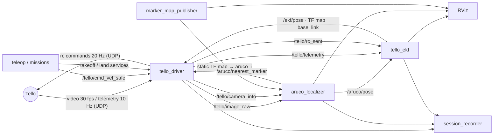

# How the system works (as built)

This page describes what is **implemented and running today** on the real Tello (the target design is in
[ARCHITECTURE.md](ARCHITECTURE.md)). Everything runs on one laptop: Windows for the Wi-Fi link to the drone,
Ubuntu 24.04 in WSL2 for ROS 2 Jazzy. One launch file starts the whole pipeline:

```bash
ros2 launch tello_driver real.launch.py            # real drone
ros2 launch tello_driver real.launch.py mock:=true # simulated drone, same nodes (no hardware)
```

## Pipeline at a glance



1. The **driver** talks to the Tello (djitellopy) and republishes its video and telemetry.
2. The **ArUco localizer** detects the wall markers and computes the drone pose in the room (`map` frame) from
   the marker map measured beforehand.
3. The **EKF** fuses that pose with the commands really sent, the downward distance sensor and the IMU heading,
   using the drone model identified in flight. It compensates the ~0.5 s delay and keeps estimating the position
   for a few seconds when no marker is in view.
4. The **driver** sends the velocity commands of the teleop or of a mission, after its safety layers (position
   hold, free-space zone, ceiling, wall ahead), which use the EKF.

## ROS 2 nodes (started by `real.launch.py`)

| Node | Package / file | Subscribes | Publishes | What it does |
|---|---|---|---|---|
| `tello_driver` | `tello_driver/driver.py` (link, video, takeoff/landing, ROS wiring) + `safety.py` (hold and guards, no ROS: `CommandFilter.filter`) + `zone.py` (flight zone grid) + `fake_tello.py` (`mock:=true`) + `video_reader.py` (default video reader; `low_latency_video:=false` = djitellopy) | `/tello/cmd_vel_safe` (Twist), `/ekf/pose`, `/aruco/nearest_marker` | `/tello/image_raw` (rgb8, 960×720), `/tello/camera_info`, `/tello/telemetry` (JSON), `/tello/rc_sent` (Twist) | Link to the drone; services `~/takeoff`, `~/land`, `~/emergency`; climb after takeoff; position hold; safety guards (below); video watchdog; `mock:=true` = simulated drone |
| `aruco_localizer` | `aruco_localization/aruco_localizer.py` | `/tello/image_raw`, `/tello/camera_info` | `/aruco/pose` (PoseWithCovariance), TF `map → base_link_aruco`, `/aruco/debug_image`, `/aruco/path`, `/aruco/sight_lines`, `/aruco/nearest_marker` (Float32) | One joint PnP over the corners of all visible markers; single-marker poses disambiguated (tilt prior, same-place test, temporal continuity); reprojection limits 3 px (one marker) / 8 px (several) |
| `tello_ekf` | `tello_driver/ekf_node.py` (+ `ekf_core.py`) | `/aruco/pose`, `/tello/telemetry`, `/tello/rc_sent` | `/ekf/pose` (30 Hz), `/ekf/velocity`, `/ekf/path`, TF `map → base_link` | Drone state estimate (model and measurements below) |
| `marker_map_publisher` | `aruco_localization/marker_map_publisher.py` | — | static TF `map → aruco_i`, `base_link → tello_camera_optical`; `/aruco/map_markers`, `/tello/body_markers`, `/room/mesh`, `/room/flight_zone`, `/room/free_space` (OccupancyGrid) | The marker map, the drone body and camera view, the scanned room, the free space |
| `session_recorder` | `tello_driver/session_recorder.py` | `/aruco/debug_image`, `/aruco/pose`, `/tello/telemetry`, `/tello/rc_sent`, `/ekf/pose` | files in `~/tello_ws/sessions/<time>/` | Records every flight: images (1/s), poses, EKF, commands sent, telemetry, summary |
| `rviz2` | `tello_driver/config/real.rviz` | everything above | — | 3D view: room scan, markers, free space, drone, camera view, trajectories |

## Programs you run in a second terminal

| Command | File | What it does |
|---|---|---|
| `ros2 run tello_driver tello_teleop_gui` | `teleop_gui.py` | Keyboard window: the drone moves while a key is held, stops when released (`t` take off, arrows, `i/k` up/down, `j/l` turn, `1/2/3` speed, `g` land, `x` emergency) |
| `ros2 run tello_driver tello_teleop` | `teleop.py` | Same keys in the terminal (each press moves 0.35 s) |
| `ros2 run tello_driver tello_step_test` | `step_test.py` | Identification flight: velocity doublets on each axis, then fits the model (`tello_step_fit`) |
| `ros2 run tello_driver tello_step_fit <folder>` | `step_fit.py` | Fits `tau dv/dt = K u(t-L) - v` per axis on a recorded identification flight |
| `ros2 run tello_driver tello_marker_tour` | `marker_tour.py` | Survey turn, then approach and back off in front of every marker |
| `ros2 run tello_driver tello_goto 49 35` | `goto_markers.py` | Takeoff anywhere (>= 1 m from walls), find the markers (turn on the spot), room centre, then for each marker: face it, go ~0.9 m in front of it (nose kept on the marker, EKF drift cancelled), back to the centre; then back above the pad and land. Band mode by default. Tested on 4 fake drones in parallel (different starts, drift up to 10 cm/s): 1-12 cm from the target points |
| `ros2 run tello_driver tello_strike` | `strike.py` | Planned trajectories: fast patrol legs and strike / retreat on target markers (balloon rehearsal) |

All missions: ENTER takes off; **any key lands**; Ctrl+C lands; they search by turning when the markers are lost
and land after 15 s without any.

## Topics

| Topic | Type | From → to | Content |
|---|---|---|---|
| `/tello/image_raw` | sensor_msgs/Image | driver → localizer | Camera, 960×720 rgb8, ~30 fps, stamped at reception |
| `/tello/camera_info` | sensor_msgs/CameraInfo | driver → localizer | Intrinsics from `config/tello_camera.yaml` (fx 910, RMS 0.24 px) |
| `/tello/telemetry` | std_msgs/String (JSON) | driver → EKF, missions | Battery, height (`h`), distance sensor (`tof`), IMU yaw, velocities, `flying`, `busy` |
| `/tello/cmd_vel_safe` | geometry_msgs/Twist | teleop / missions → driver | Body-frame velocity request (m/s, rad/s) |
| `/tello/rc_sent` | geometry_msgs/Twist | driver → EKF, recorder | Command really sent after hold and guards (EKF input) |
| `/aruco/pose` | PoseWithCovarianceStamped | localizer → EKF | Raw marker pose of `base_link` in `map` |
| `/aruco/nearest_marker` | std_msgs/Float32 | localizer → driver | Distance to the closest marker in view, from its size in the image |
| `/ekf/pose`, `/ekf/velocity` | PoseWithCovarianceStamped, TwistStamped | EKF → driver, missions | Filtered state (`map` frame) |
| `/aruco/debug_image` | sensor_msgs/Image | localizer → RViz, recorder | Camera image with the detections drawn |
| `/room/free_space` | nav_msgs/OccupancyGrid | map publisher → RViz | No-fly cells (black) from the room scan |

## Frames (TF)

| Frame | Parent | Published by | Meaning |
|---|---|---|---|
| `map` | — | — | Room frame: origin on the floor below marker 6, z up (height above the floor) |
| `aruco_<id>` | `map` | marker_map_publisher (static) | Each wall marker, from `config/markers.yaml` |
| `base_link` | `map` | tello_ekf | The drone (filtered) |
| `base_link_aruco` | `map` | aruco_localizer | The drone (raw marker pose) |
| `tello_camera_optical` | `base_link` | marker_map_publisher (static) | Camera (z forward, x right, y down), 5 cm ahead of the body |

## Safety layers in the driver (whatever program sends the commands)

| Layer | Rule |
|---|---|
| Command watchdog | No command for 0.5 s → hover |
| Climb after takeoff | Climbs to `takeoff_height` (auto: median marker height − 0.3 m, ≤ 2.0 m; band mode: the middle of the band, 1.85 m) with joystick commands, closed loop on the distance sensor / EKF |
| Band mode | `band:=true` (launch and missions): free zone computed for the 1.70–2.00 m band only (`config/flight_zone_band.yaml`: all the furniture is below, so the zone is larger), missions plan inside the band, identification aborts outside band ± 0.3 m |
| Position hold | No horizontal command → hold where the drone stops; no vertical command → hold that height. The Tello's own optical-flow hold does not work on the plain floor of the room (vgx = vgy = 0 in flight), so the driver does it: position predicted L_u ahead, desired speed kp·error, model inversion with the EKF velocity and learnt drift (`/ekf/drift`), small integral. Gains `hold_kp` 0.8, `hold_kv` 0.4, `hold_ki` 0.15, `hold_kp_z` 1.0, changeable in flight (`ros2 param set /tello_driver hold_kp 1.0`). Fake drone with 8/5 cm/s drift: within 2.4 cm at hover (old PI: 13 cm), 9 cm overshoot after a key release (old: 24 cm). `flight_report.py` prints the real hover spread |
| Ceiling | `max_height` 2.6 m: predicts the height 1 s ahead, brakes, descends above the limit |
| Free space | Distance to the nearest scanned obstacle (margin 0.35 m), predicted 1 s ahead with the identified model; brakes, pushes back; no certain pose → horizontal moves slowed to `blind_speed` 0.15 m/s (they were blocked: the pilot could not get out). The guard that acted is in the telemetry field `guard`; `cmd_in.csv` records what was asked |
| Before land / takeoff | rc zeroed: the Tello keeps flying with the last rc command while a blocking SDK command runs |
| EKF without markers | Drift bounded to 0.10 m/s and faded out after 1 s without markers (it ran the estimate 5 m away on flight 225048; replay: 0.75 m) |
| Wall ahead | A marker closer than 0.7 m in the image → no forward motion, back off |
| Low battery | ≤ 12 % → lands |
| Land | A land request always goes through, even during another command |

## Models and estimation

**Identified on the real drone** (identification flight, Nov 11): per horizontal axis, the velocity follows the
command with a first-order lag and a delay, `tau dv/dt = K u(t - L) - v`, with K ≈ 1.1–1.25, tau ≈ 0.55 s and a
total delay L ≈ 0.5 s (command → marker pose). Without the model, a proportional controller cannot exceed
Kp ≈ 0.6 1/s without oscillating.

**EKF** (`ekf_core.py`): state `[x, y, z, vx, vy, vz, yaw, b, dx, dy]` (b = IMU heading offset, dx/dy = drift
velocity learnt while markers are seen). Inputs: the commands really sent (delay L_u = 0.30 s). Measurements:
marker pose applied at the time the image was taken (L_v = 0.20 s, re-propagated to now, chi-square gate),
distance sensor (gated: rejected over furniture), IMU heading.

**Planned trajectories** (`trajectory.py`, `strike.py`): minimum-jerk quintics, duration from v_max, a_max and the
command limit, checked against the free space before flying; tracked with the model as feedforward
`u = (v_d + tau a_d) / K` taken L_u ahead, plus PI feedback on the EKF.

## Configuration files

| File | Made by | Content |
|---|---|---|
| `config/markers.yaml` | `scripts/room_mapper.py` (photos + bundle adjustment) | Dictionary (DICT_6X6_50), real printed size (0.1889 m: the sheets were shrunk ~6 % by the printer; set from the room scan), full pose of every marker (optional per-marker `size`) |
| `config/tello_camera.yaml` | `scripts/calibrate_camera.py` | Camera intrinsics and distortion |
| `config/flight_zone.yaml` + `_grid.npz` + `.png` | `tools/free_zone.py` (room scan) | Mission rectangle and free-space grid (distance to obstacles), heights 1.4–2.4 m |
| `config/flight_zone_band.yaml` + `_grid.npz` + `.png` | `tools/free_zone.py --z 1.7 2.0` | Same for the band mode (1.70–2.00 m) |
| `config/home.yaml` (local, not in git) | `tools/set_home.py` (learnt from the climbs of real flights) | Takeoff pad (marker 48 on the floor): position and heading. The EKF starts there; the missions fly back above it and land on it |
| `src/tello_driver/config/fastdds_local.xml` | — | ROS 2 transport: loopback only, packets ≤ 1400 B (WSL mirrored networking drops larger UDP packets) |
| `src/tello_driver/config/real.rviz` | — | RViz layout |

## Tools (Windows or Ubuntu, no ROS needed)

| Tool | What it does |
|---|---|
| `scripts/first_flight.py`, `scripts/tello_udp_check.py` | First flight with the keyboard; Wi-Fi / UDP link check |
| `scripts/calibrate_camera.py` | Guided camera calibration with a checkerboard |
| `scripts/room_mapper.py` | Marker map from photos (incremental PnP + bundle adjustment) |
| `tools/make_print_sheets.py` | Printable markers (any ID range, US Letter or A4) and checkerboard |
| `tools/room_mesh_to_map.py` | Puts the phone scan (Scaniverse OBJ) in the `map` frame for RViz |
| `tools/free_zone.py` | Obstacle-free flight space from the scan |
| `tools/measure_latency.py` | Perception latency of a recorded flight: ArUco heading vs IMU heading during turns (first reliable value: ~190 ms) |
| `tools/video_latency_bench.py` | Video reader latency bench on a fake H.264 Tello stream (no drone): decoding on the PC costs ~45-50 ms; the main latency is in the drone and the Wi-Fi |
| `tools/ekf_replay.py` | Replays a recorded flight through the EKF with markers hidden: dead-reckoning error |
| `tools/align_scan.py` | Aligns the phone scan on the marker map from the markers found in its texture (scale, residual per marker) |
| `tools/set_home.py` | Learns the takeoff pad from the first marker poses of each climb (median over the flights) |
| `tools/flight_report.py` | After a flight: markers in view, pose jumps, ArUco height vs distance sensor, time in the band, mission tracking error; `report.txt` + `report.png` in the session |

## Simulation

| Option | What it is |
|---|---|
| `real.launch.py mock:=true` | Same nodes; the driver renders the real marker map seen by a virtual camera and moves it with the identified dynamics (first order, 0.30 s command delay, 0.20 s video delay). `FAKE_DRIFT=vx,vy` adds drift, `FAKE_BLACKOUT=a:b` hides the markers |
| `src/tello_sim` (Gazebo Harmonic) | Gazebo room with markers and a bridge publishing the same topics (`sim.launch.py`) |

Known limit: the simulation has a perfect marker map, perfect images and constant drift. The real flights show
marker-map inconsistencies (pose jumps, ArUco height 10–20 cm above the distance sensor) and a variable drift, so
results must be validated on the drone.

## Recorded data

Every flight is saved in `~/tello_ws/sessions/<time>/` (`poses.csv`, `ekf.csv`, `rc_sent.csv`, `telemetry.csv`,
`frames/`, `summary.json`); identification, tour and strike runs add their own folder (`step_*`, `tour_*`,
`strike_*`) with commands, fitted model or tracking results.
