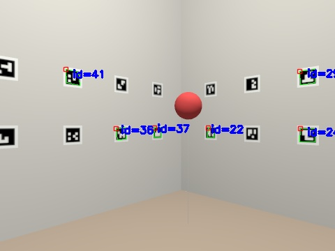

# tello_sim: Gazebo room for the Tello

A copy of the flight room in **Gazebo Harmonic + ROS 2 Jazzy** (Ubuntu 24.04). The walls are covered with the ArUco markers of [`config/markers.yaml`](../../config/markers.yaml), the same file the real localizer uses. The room also holds a kinematic Tello with its forward camera, the fixed Logitech camera and a tethered balloon.



**The simulator publishes the same topics as the real drone**, so the rest of the stack runs unchanged:

| Topic | Real drone | Simulator |
|---|---|---|
| `/tello/image_raw`, `/tello/camera_info` | Tello driver | Gazebo camera + `sim_adapter` (latency 200 ms, jitter, 3% drops) |
| `/tello/telemetry` | Tello state (JSON) | `sim_adapter` (Tello-like units: dm/s, cm, deg) |
| `/tello/cmd_vel_safe` | → `rc` commands | → first-order lag (τ = 0.3 s) → Gazebo |
| `/sim/ground_truth`, TF `map → base_link_gt` | – | Exact pose, for evaluation only |

## Run

```bash
# once: install the ROS <-> Gazebo bridge
sudo apt install ros-jazzy-ros-gz

cd ~/tello_ws && colcon build --symlink-install && source install/setup.bash
ros2 launch tello_sim sim.launch.py                        # headless: test flight + localization evaluation
ros2 launch tello_sim sim.launch.py gui:=true gpu:=true    # at the PC: Gazebo GUI, RViz, full-res cameras
```

The headless run flies a scripted square (steered by ground truth). It compares `/aruco/pose` with the ground truth and writes `~/tello_ws/sim_out/eval_latest.json` (position and yaw RMSE, with and without the latency effect) plus annotated frames in `~/tello_ws/sim_out/debug/`.

## Validated so far

Localizer geometry on frames rendered by Gazebo, at three known poses (480×360 image):

| Truth (x, y, z, yaw) | Estimate | Error | Markers |
|---|---|---|---|
| 2.00, 1.75, 1.20, 0° | 1.999, 1.743, 1.192, 0.1° | 1.1 cm | 10 |
| 1.20, 1.00, 1.00, 45° | 1.217, 0.978, 1.002, 45.4° | 2.8 cm | 6 |
| 3.00, 2.50, 1.40, 180° | 3.010, 2.504, 1.397, 179.9° | 1.1 cm | 6 |

## Gotchas (WSL2)

- **`source /opt/ros/jazzy/setup.bash` hides `gz sim`**: ROS puts its own `gz` tools first. The launch file runs `/usr/bin/gz` with the system paths; do the same if you start Gazebo by hand.
- **Over SSH there is no GPU rendering.** The WSLg display only answers when someone is logged in on the PC, so Gazebo falls back to CPU rendering. That is why the default is 480×360 at 10 Hz (`gpu:=false`). Use `gpu:=true` when you sit at the PC.
- The first camera frame takes ~20 s (shader compilation with CPU rendering).
- A `numpy` 2 in `~/.local` breaks the system OpenCV. The launch file sets `PYTHONNOUSERSITE=1`.
- The system OpenCV is 4.6 (old ArUco API); the localizer supports both 4.6 and ≥ 4.7.
- The drone is **kinematic** (velocity-commanded, no rotor physics): the real Tello's inner loop is a black box, and task F1 will identify its response.
